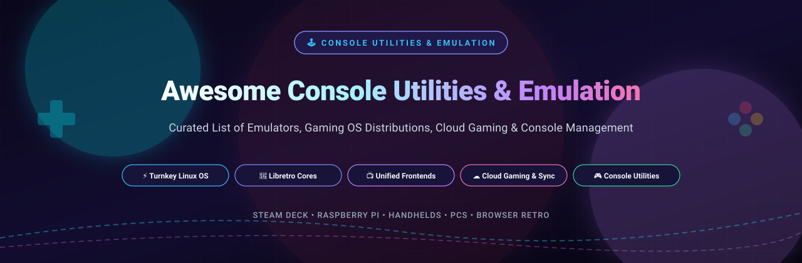

# Awesome-Console-Utilities-Emulation

  

  
  
  
  
  
  

---

## 🎮 Top Console Utilities & Emulation Ecosystem

**A Curated List of SaaS/Hosted Platforms & Open-Source GitHub Projects**  
*Focused on Console Emulation Frontends, Retro Gaming OS Distributions, Libretro Cores, Save-Sync & Remote Console Utilities*  

**Last updated: November 2026**

This repository is an SEO-optimized, community-curated catalog tracking notable **SaaS/hosted platforms** and **open-source software** for **Console Utilities & Emulation**. These cutting-edge tools emulate, organize, scrape, launch, stream, and synchronize retro and modern gaming consoles across dedicated Linux gaming OS distributions, Steam Decks, Raspberry Pis, desktop frontends, handheld PCs, and browser-based WebAssembly portals.

Whether you are looking for unified frontends (`RetroArch`, `OpenEmu`, `Playnite`), turnkey console operating systems (`Batocera.linux`, `RetroPie`, `Lakka`), standalone console emulators (`RPCS3`, `PCSX2`, `Dolphin`, `DuckStation`, `PPSSPP`, `mGBA`), or cloud-streamed retro environments (`GeForce NOW`, `Antstream Arcade`, `Shadow PC`), this list features the most active solutions ranked and organized for easy exploration.

---

## 📑 Table of Contents

- [📊 Sector Overview & Market Dynamics](#-sector-overview--market-dynamics)
- [☁️ SaaS / Hosted Platforms](#️-saashosted-platforms)
- [💻 Open-Source GitHub Projects](#-open-source-github-projects)
- [📈 Star History](#-star-history)
- [🤝 How to Contribute](#-how-to-contribute)
- [💖 Support & Sponsorship](#-support--sponsorship)
- [⚖️ Disclaimer](#️-disclaimer)

---

## 📊 Sector Overview & Market Dynamics

The global video game emulation and cloud gaming market represents an estimated sector valuation of **$6.5 Billion to $8.2 Billion** in 2026, expanding at an annual CAGR exceeding 35% fueled by handheld gaming PCs (e.g., Steam Deck, ASUS ROG Ally), mobile controller accessories, and high-speed fiber/5G networks. 

From an economic perspective, the market is **moderately fragmented**: 
- **Cloud Infrastructure & Remote Play**: Exhibits strong, concentrated "winner-take-most" characteristics dominated by hyperscale cloud titans (Microsoft Xbox Cloud Gaming, NVIDIA GeForce NOW, Sony PlayStation Plus) due to immense capital expenditure requirements for low-latency edge GPU data centers.
- **Emulation Software, Frontends & Utilities**: Highly fragmented and decentralized, fiercely powered by community-governed open-source developers, volunteer preservationists, and independent micro-SaaS providers who maintain independent cross-platform core compatibility without vendor lock-in.

---

## ☁️ SaaS / Hosted Platforms

Below is a curated comparison of hosted cloud gaming VMs, remote streaming portals, and managed emulation metadata platforms.

| Product / Platform | Company Valuation / Revenue | Pricing | Free Tier / Trial Limits | Description |
| :--- | :--- | :--- | :--- | :--- |
| **[Xbox Cloud Gaming (Microsoft)](https://xbox.com/play)** | ~$3.6T Market Cap | Starting at $22.99/mo (Xbox Game Pass Ultimate) | Free tier available for select F2P titles (e.g. Fortnite) capped at 30 minutes per session with pre-roll ads; promotional 14-day trials occasionally offered | Official first-party console cloud streaming catalog enabling direct play of Xbox console and backward-compatible retro releases across TVs, PCs, handhelds, and mobile devices. |
| **[NVIDIA GeForce NOW](https://nvidia.com/geforce-now)** | ~$3.0T Market Cap | Starting at $9.99/mo (Performance tier; $19.99/mo for Ultimate) | Free tier forever: limited to 60-minute continuous sessions, standard queue waiting times with up to 2-min video ads, basic rig specs (up to 1080p/60fps), and no ray tracing | Flagship cloud gaming service streaming owned PC and console-port titles to low-power devices, smart TVs, and handhelds with up to 4K/120fps capability. |
| **[PlayStation Plus Cloud Streaming (Sony)](https://playstation.com/ps-plus)** | ~$159B Market Cap | Starting at $19.99/mo (PS Plus Premium; $159.99/yr) | No permanent free tier (free PSN account covers F2P games only); regional 7-day to 14-day free trials available for select new accounts requiring payment info | Sony's cloud streaming tier offering remote access to classic PS1, PS2, PSP, PS3, and modern PS4/PS5 console titles directly on PS5 consoles and Windows PCs. |
| **[Plex (Plex Arcade / Pass)](https://plex.tv)** | ~$100M–$250M Est. Valuation (~$132M Raised) | Starting at $6.99/mo ($69.99/yr or $749.99 lifetime) | Free tier forever: free local home network media streaming and ad-supported AVOD channels; remote personal server streaming, hardware transcoding, and offline downloads require paid pass (mobile personal playback capped at 1-min preview without unlock) | Unified home media server and cloud platform featuring retro arcade streaming integration (powered by Parsec & Atari) alongside personal media streaming libraries. |
| **[Shadow PC](https://shadow.tech)** | ~€29.5M Takeover Package (~$100M+ Raised prior) | Starting at $29.99/mo (Shadow PC Lite; $32.99–$37.99/mo for standard) | No free tier forever and no free trial (dedicated cloud GPU Windows VM infrastructure starts immediately on a paid monthly subscription) | Full high-performance cloud Windows virtual desktop service capable of running demanding PC and console emulators remotely on lightweight devices with full gamepad pass-through. |
| **[Antstream Arcade](https://antstream.com)** | ~$20M–$30.8M Funding (~$7.7M Est. Revenue) | Starting at $3.99/mo ($39.99/yr) | Free tier forever: full access to 1,300+ retro games, challenges, and tournaments supported by video advertisements and daily gem recharge limits | Dedicated retro gaming cloud subscription platform streaming over 1,300 officially licensed arcade, PS1, SNES, Genesis, and classic home computer games with cloud saves. |
| **[RetroPie Cloud / AirGPU](https://airgpu.com)** | Bootstrapped Micro-SaaS (Private) | Starting at $0.65/hour + $3.50/mo per 50GB SSD storage | No free tier and no free trial (pay-as-you-go hourly GPU compute billing with minimum initial credit deposit required) | On-demand cloud GPU virtual workstations configured to host and stream RetroArch, LaunchBox, and resource-intensive console emulators via Moonlight or Parsec. |
| **[LaunchBox Games Database & Sync (Unbroken Software)](https://launchbox-app.com)** | Bootstrapped / Privately Held Independent | Starting at $30/yr ($75 lifetime forever-updates; $25 Android license) | Free tier forever: standard LaunchBox desktop organizer with unlimited game imports, scraping, and metadata sync; premium Big Box 10-foot TV/gamepad UI requires paid license | High-performance game launcher and emulator frontend ecosystem backed by cloud database scraping, box art syncing, and community metadata integration. |

---

## 💻 Open-Source GitHub Projects

Every open-source project below includes an official live GitHub_Stars_Badge (`style=social`, `color=white`) linking directly to that repository's stargazers page, strictly sorted in **descending order of Stars_Count**.

### 🏆 High-Impact Emulators & Frontends (Ranked by Stars)

- **[Syncthing (`syncthing/syncthing`)](https://github.com/syncthing/syncthing)**   
  ⚡ *Save Synchronization*: Decentralized, open-source peer-to-peer file synchronization engine widely adopted across Steam Deck, Android, and PC to automatically keep game saves, states, and configs in sync.

- **[RPCS3 (`RPCS3/rpcs3`)](https://github.com/RPCS3/rpcs3)**   
  🎮 *PlayStation 3*: Groundbreaking multi-platform open-source Sony PlayStation 3 emulator and debugger written in C++ with advanced Vulkan rendering, high-resolution scaling, and 60+ FPS game patches.

- **[OpenEmu (`OpenEmu/OpenEmu`)](https://github.com/OpenEmu/OpenEmu)**   
  🍎 *macOS Frontend*: Modular, award-winning native macOS emulation frontend featuring responsive plug-and-play controller mapping, beautiful box art libraries, and multi-system Libretro core integration.

- **[PCSX2 (`PCSX2/pcsx2`)](https://github.com/PCSX2/pcsx2)**   
  🎮 *PlayStation 2*: Premier open-source Sony PlayStation 2 emulator featuring extensive compatibility with thousands of commercial titles, widescreen hacks, texture dumping/replacement, and Vulkan/DirectX 12 backends.

- **[Dolphin (`dolphin-emu/dolphin`)](https://github.com/dolphin-emu/dolphin)**   
  🐬 *GameCube & Wii*: Highly celebrated open-source Nintendo GameCube and Nintendo Wii emulator delivering 4K resolution upscaling, custom texture packs, netplay matchmaking, and physical Wii Remote Bluetooth support.

- **[PPSSPP (`hrydgard/ppsspp`)](https://github.com/hrydgard/ppsspp)**   
  📱 *PlayStation Portable*: Fast and portable open-source Sony PSP emulator supporting Windows, macOS, Linux, Android, and iOS with HD rendering, anisotropic filtering, and save-state synchronization.

- **[RetroArch (`libretro/RetroArch`)](https://github.com/libretro/RetroArch)**   
  👾 *Unified Frontend*: Flagship multi-platform frontend for emulators, game engines, and media players featuring unified CRT shaders, run-ahead input latency reduction, RetroAchievements integration, and netplay.

- **[Playnite (`JosefNemec/Playnite`)](https://github.com/JosefNemec/Playnite)**   
  📺 *Universal Launcher*: Extensible open-source video game library manager and fullscreen console-style UI that seamlessly aggregates Steam, GOG, Epic, and dozens of console emulators with automated scraping.

- **[RomM — Rom Manager (`rommapp/romm`)](https://github.com/rommapp/romm)**   
  🌐 *Self-Hosted Web Library*: Beautiful self-hosted open-source ROM collection manager featuring WebAssembly in-browser play, IGDB/Screenscraper metadata scraping, and automated multi-device save syncing.

- **[DuckStation (`stenzek/duckstation`)](https://github.com/stenzek/duckstation)**   
  🦆 *PlayStation 1*: High-accuracy, performance-oriented Sony PlayStation 1 (PSX) emulator with PGXP geometry correction, real-time downsampling, software & hardware renderers, and modern Qt UI.

- **[RetroPie-Setup (`RetroPie/RetroPie-Setup`)](https://github.com/RetroPie/RetroPie-Setup)**   
  🥧 *Raspberry Pi Suite*: Legendary modular shell script collection for transforming Raspberry Pi, ODroid, and Debian/Ubuntu systems into all-in-one retro gaming stations powered by EmulationStation and RetroArch.

- **[ScummVM (`scummvm/scummvm`)](https://github.com/scummvm/scummvm)**   
  🧭 *Adventure Game Engine*: Universal open-source re-implementation of classic point-and-click graphical adventure game engines allowing classic PC and console adventures to run natively on modern systems.

- **[mGBA (`mgba-emu/mgba`)](https://github.com/mgba-emu/mgba)**   
  🕹️ *Game Boy Advance*: Premier fast, cycle-accurate open-source Nintendo Game Boy, Game Boy Color, and Game Boy Advance emulator featuring solar sensor, tilt sensor, rumble, and multiplayer link cable emulation.

- **[melonDS (`melonDS-emu/melonDS`)](https://github.com/melonDS-emu/melonDS)**   
  🍈 *Nintendo DS*: Rapidly developing open-source Nintendo DS and DSi emulator delivering accurate 2D/3D hardware rendering, local Wi-Fi connectivity, online multiplayer emulation, and microphone input.

- **[EmulatorJS (`EmulatorJS/EmulatorJS`)](https://github.com/EmulatorJS/EmulatorJS)**   
  🌐 *Browser WebAssembly*: Turnkey open-source web console emulator built with WebAssembly and JavaScript, enabling instant retro console gaming directly inside modern web browsers without native installs.

- **[VisualBoyAdvance-M (`visualboyadvance-m/visualboyadvance-m`)](https://github.com/visualboyadvance-m/visualboyadvance-m)**   
  🎮 *Game Boy Series*: Modern continuation of the classic VBA emulator supporting GB, GBC, and GBA with HQx filtering, pixel shaders, cheat systems, and link netplay support.

- **[BizHawk (`TASVideos/BizHawk`)](https://github.com/TASVideos/BizHawk)**   
  🎯 *Multi-System TAS*: Multi-system open-source emulator designed specifically for Tool-Assisted Speedruns (TAS) featuring precise frame stepping, memory search, Lua scripting, and rewinding.

- **[EmuDeck (`dragoonDorise/EmuDeck`)](https://github.com/dragoonDorise/EmuDeck)**   
  ⚙️ *Handheld Configurator*: Comprehensive configuration script that automates the installation, cloud backup, hotkeys, and integration of dozens of emulators directly into SteamOS and desktop Linux.

- **[Batocera.linux (`batocera-linux/batocera.linux`)](https://github.com/batocera-linux/batocera.linux)**   
  ⚡ *Turnkey Linux OS*: Dedicated plug-and-play open-source retro-gaming Linux distribution designed to boot from USB thumb drives, SD cards, PCs, and handhelds with zero OS overhead.

- **[Chiaki-ng (`streetpea/chiaki-ng`)](https://github.com/streetpea/chiaki-ng)**   
  📡 *PlayStation Remote Play*: Next-generation open-source PlayStation 4 and PlayStation 5 Remote Play client engineered for low latency, HDR streaming, gyro controls, and Steam Deck integration.

- **[Greenlight (`unknownskl/greenlight`)](https://github.com/unknownskl/greenlight)**   
  🟢 *Xbox Streaming Client*: Open-source native desktop and handheld client for Xbox home console streaming and Xbox Cloud Gaming built with TypeScript and WebRTC.

- **[DOSBox-Staging (`dosbox-staging/dosbox-staging`)](https://github.com/dosbox-staging/dosbox-staging)**   
  💾 *MS-DOS Emulator*: Modernized, active fork of DOSBox focusing on usability, pristine audio reproduction, modern controller support, CRT shaders, and variable refresh rates.

- **[ares (`ares-emulator/ares`)](https://github.com/ares-emulator/ares)**   
  🔬 *Multi-System Accuracy*: High-performance, cycle-accurate multi-system emulator preserving N64, PlayStation, Mega Drive, SNES, and arcade hardware with strict hardware fidelity.

- **[Lakka (`libretro/Lakka-LibreELEC`)](https://github.com/libretro/Lakka-LibreELEC)**   
  🐧 *Minimalist Gaming OS*: Official lightweight Linux distribution based on LibreELEC that boots directly into RetroArch, turning cheap single-board computers and old PCs into dedicated game consoles.

- **[Mesen 2 (`SourMesen/Mesen2`)](https://github.com/SourMesen/Mesen2)**   
  🕹️ *Multi-System Core*: Ultra-precise multi-system emulator supporting NES, SNES, Game Boy, PC Engine, and ColecoVision equipped with powerful debugging and disassembly toolsets.

- **[Mupen64Plus Core (`mupen64plus/mupen64plus-core`)](https://github.com/mupen64plus/mupen64plus-core)**   
  🍄 *Nintendo 64*: Modular open-source cross-platform N64 emulator library featuring dynamic recompilers, high-resolution texture loaders, and GlideN64 plugin ecosystems.

- **[RetroDECK (`RetroDECK/RetroDECK`)](https://github.com/RetroDECK/RetroDECK)**   
  📦 *Flatpak Gaming Hub*: Sandboxed all-in-one Flatpak emulation suite bundling RetroArch, standalone emulators, and ES-DE into a clean, immutable container for Steam Deck and Linux.

- **[cobanov/ps5lm (`cobanov/ps5lm`)](https://github.com/cobanov/ps5lm)**   
  🎮 *Console Utility*: Open-source PlayStation 5 console utility and local manager designed to streamline PS5 file manipulation, companion workflows, and remote payload interactions.

- **[GBE+ (`shonumi/gbe-plus`)](https://github.com/shonumi/gbe-plus)**   
  👾 *Game Boy Experimental*: Highly experimental open-source Game Boy, GBC, and GBA emulator exploring obscure console peripherals (cameras, printers, sonar, motion sensors).

---

## 📈 Star History

---

## 🤝 How to Contribute

Contributions are wholeheartedly welcome! Follow these steps to submit a project:

1. **Fork the Repository** on GitHub.
2. **Add or Edit Entries** in [README.md](file:///C:/Users/ishan/Documents/Projects/Awesome-Console-Utilities-Emulation/README.md) following the existing Markdown schema.
3. **Include Key Data**: Platform name, verified link, official Stars_Badge (`style=social&color=white`), and a concise 1–2 sentence description.
4. **Submit a Pull Request** with a brief summary explaining the merit and relevance of the addition.

---

## 💖 Support & Sponsorship

If you find this curated list helpful for retro gaming, emulator modding, or game preservation, consider supporting the maintenance of this repository:

- ⭐ **Star this repository** to help others discover it across GitHub.
- 🍴 **Fork & Share** it with friends, Discord communities, and social media.
- ☕ **Buy me a coffee & Sponsor**: Support ongoing maintenance and updates directly via my [GitHub Sponsors Dashboard](https://github.com/sponsors/ishandutta2007). Your support funds domain hosting, benchmark testing on physical handheld hardware, and ongoing curation!

---

## ⚖️ Disclaimer

- This is an independent, **community-curated** educational catalog. Mention of software does not imply formal endorsement.
- Video game console emulation software is legally recognized for playing legally acquired backups, physical optical discs, public domain homebrew titles, and open-source software. Respect copyright laws and digital preservation guidelines in your local jurisdiction.
- Always implement proper TLS encryption and strict authentication when deploying self-hosted web ROM portals (such as RomM or EmulatorJS) to the public internet.

---

  <b>Made with ❤️ for retro gamers, emulation engineers, handheld modders, and preservationists.</b>

